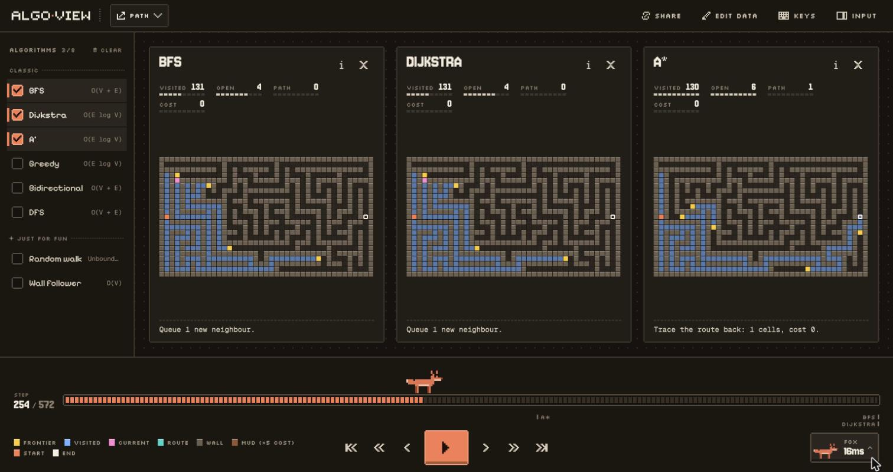
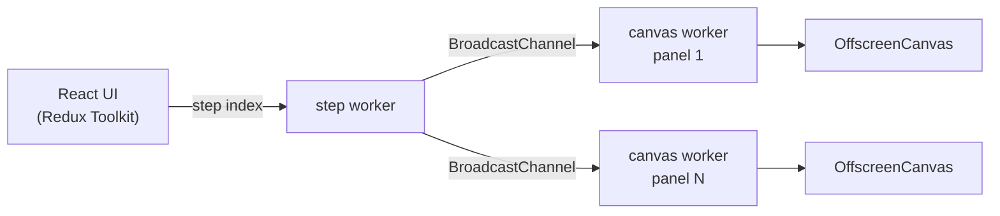
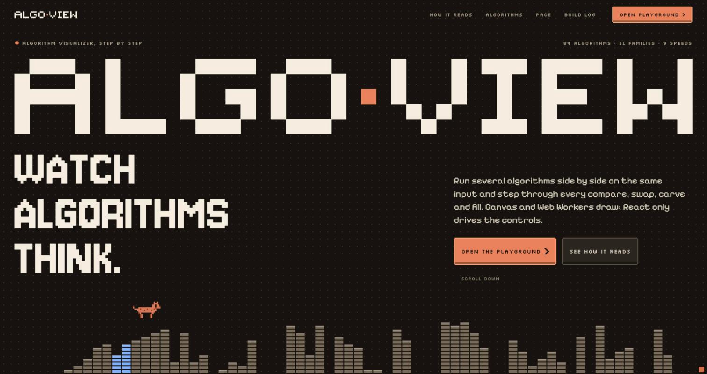

# Algo View

[](https://github.com/Snowyq/algo-view/actions/workflows/ci.yml)


[](LICENSE)

An algorithm visualizer you can step through. Pick a few algorithms, give
them the same input and watch them run side by side, one compare, swap or
fill at a time.

**Live demo:** https://algorithms-visualizer-alpha.vercel.app/



## Features

- 84 algorithms in 11 families: sorting, path finding, mazes, dynamic
  programming, cellular automata, flood fill, convex hull, trees, graphs,
  string matching and searching.
- Several panels on one shared timeline (as many as fit the screen):
  play, pause, step, scrub, nine speeds.
- A caption under each panel that says what the step does, with the real
  values, plus a colour legend for every step type.
- Your own input: draw walls and mud on grids, click points, type values,
  text or edges.
- Code view with line breakpoints, a measured growth chart (fits the
  exponent from real runs) and a results summary that ranks the panels.
- Share links that restore the whole setup, and keyboard shortcuts
  (press `?` in the playground).

## How it works



- Each algorithm runs once and records every step (with counters and the
  code line it is on). Replaying a step reads from periodic snapshots, so
  scrubbing a 500k-step run stays instant.
- Drawing happens in Web Workers on an `OffscreenCanvas`. The main thread
  only renders the controls, so a heavy panel never blocks the UI.
- Categories share one runtime: a worker only supplies `draw()` and
  `describe()`, and an input panel is a few lines on top of a shared hook.

## Stack

Next.js (App Router), React 19, TypeScript (strict), Redux Toolkit,
styled-components, Web Workers + OffscreenCanvas, GSAP and Lenis on the
landing page. Vitest for tests, GitHub Actions for CI.

## Tests

About 1,350 tests check the algorithms against reference answers, not
snapshots: every sort ends sorted, every path search finds a shortest
route, every maze is perfect, MST weights agree, hulls match a brute-force
hull, trees keep their invariants, and share links round-trip.

```
pnpm test            # run once
pnpm test:coverage   # with a coverage report
```

## Running locally

Requires Node 22+ and pnpm.

```
pnpm install
pnpm dev
```

| Script              | What it does                         |
| ------------------- | ------------------------------------ |
| `pnpm build`        | production build                     |
| `pnpm lint`         | ESLint                               |
| `pnpm typecheck`    | `tsc --noEmit`                       |
| `pnpm format:check` | Prettier check                       |

## Project structure

```
algorithms/   algorithm classes per family, registry, share-link codecs
workers/      canvas workers per family + shared runtime
features/
  landing/    landing page
  play/       playground: Redux slice, panels, timeline, inspector
utils/        input generators and small helpers
```



## License

MIT
